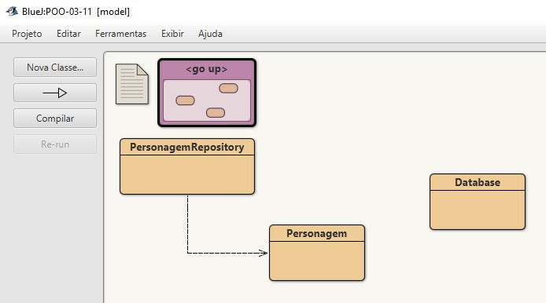
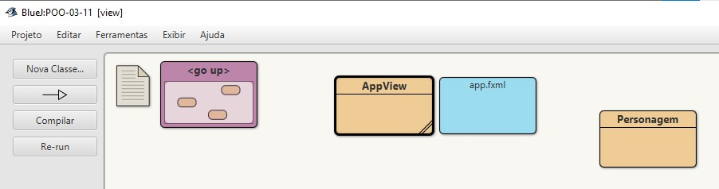
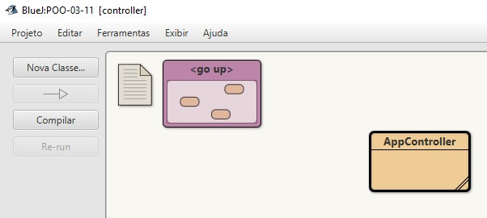
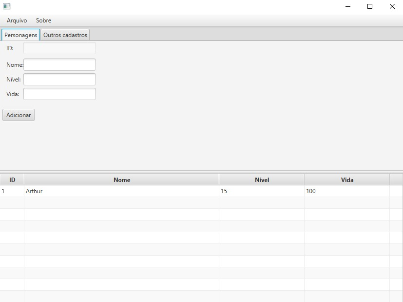

# Sistema de Cadastro de Personagens — JavaFX

## Descrição

A aplicação permite cadastrar e consultar personagens de um RPG por meio de uma interface gráfica desenvolvida em JavaFX.

Cada personagem possui os seguintes atributos:
- ID: identificador único gerado automaticamente.
- Nome: nome do personagem.
- Nível: nível atual do personagem.
- Vida: quantidade de pontos de vida.

## Tecnologias utilizadas

- Java
- JavaFX
- Scene Builder
- SQLite
- ORMLite
- BlueJ

## Organização do projeto

O projeto segue o padrão arquitetural MVC, dividido em três pacotes:

- **model:** contém as classes de entidade e persistência de dados.
- **view:** contém a interface gráfica e a classe de representação dos personagens.
- **controller:** contém a lógica de controle e comunicação entre a interface e o banco de dados.

## Funcionalidades implementadas

- **Cadastro (Create):** permite cadastrar novos personagens no banco de dados.
- **Consulta (Retrieve):** apresenta os personagens cadastrados em uma tabela.

Os dados são armazenados em um banco de dados SQLite, permitindo que os registros permaneçam salvos mesmo após o encerramento da aplicação.

## Como executar

1. Abra o projeto no BlueJ.
2. Verifique se as bibliotecas necessárias do JavaFX e ORMLite estão configuradas.
3. Execute a classe `AppView`, localizada no pacote `view`.
4. A janela da aplicação será aberta, permitindo cadastrar e consultar personagens.

O banco de dados `personagens.sqlite` é utilizado para armazenar os registros.

## Capturas de tela

### Interface principal

### Cadastro de personagem

